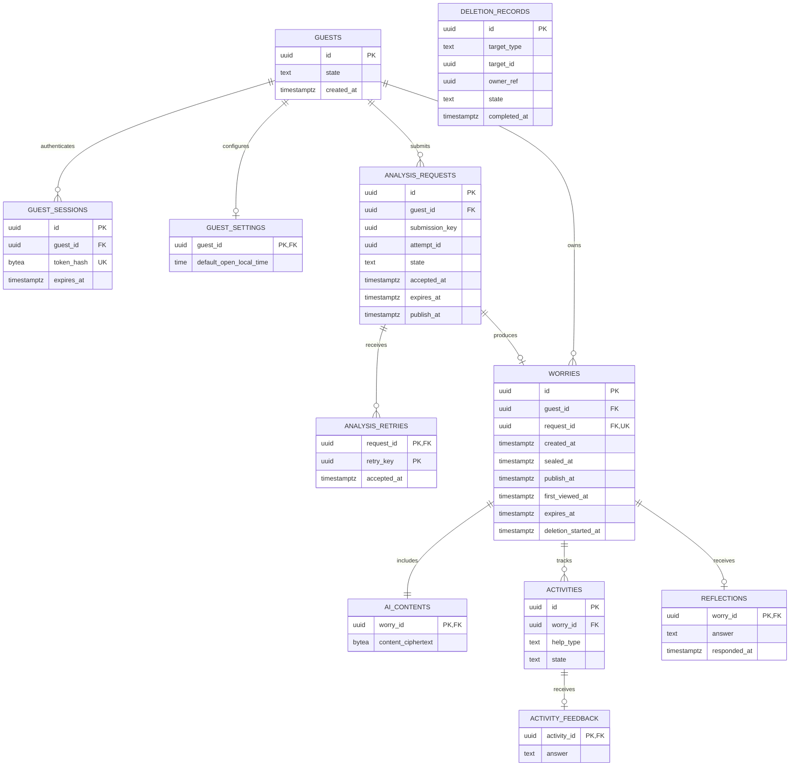
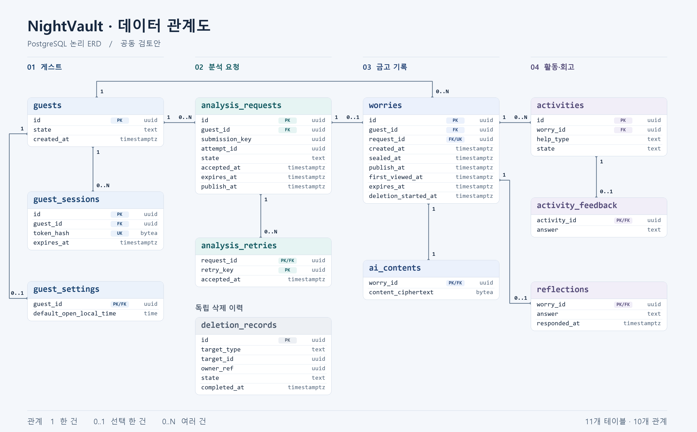

# NightVault ERD · 1차 공동 검토안

[통합 개발 계획](../development-plan.md) · [공개 API](../api/openapi.yaml) · [Spring–Python 분석 계약](../api/ai-contract.yaml)

**범위**는 게스트 인증부터 걱정 접수·봉인·공개·최초 열람과 개별 삭제 경계까지다. 활동·평가·회고의 관계는 BE2 검토용으로 표시했다. 알림, 과거 경험 검색, 전체 삭제의 세부 API와 물리 스키마는 다음 단계에서 확정한다.

**설계 가정**은 Spring Boot 한 개와 PostgreSQL, 비공개 HTTP로 연결한 Python 분석 서비스다. 브라우저는 같은 출처의 Spring API를 사용한다. 아래 테이블·컬럼 이름, 잠금 방식, 오류 코드와 HTTP 경로는 구현 전 팀 합의에 사용할 제안이다.

## 관계도

세 표현은 같은 테이블과 관계를 보여준다. 복합 키와 삭제·만료 동작은 아래 제약 설명을 함께 확인한다.

### 1. Mermaid

### 2. PNG

[PNG 원본 열기](erd.png) · [추가 ERD 이미지](erd2.png)

### 3. DBML

DBML 원본을 dbdiagram.io에 붙여 넣어 관계를 탐색하거나 편집할 수 있다. 대표 컬럼과 관계에 더해 복합 키 제약을 표기한 논리 설계 초안이다. [DBML 파일](erd.dbml)

## 엔터티와 불변 조건

| 엔터티 | 저장할 내용 | 제약과 책임 |
| --- | --- | --- |
| `guests`, `guest_sessions` | 게스트 상태, 인증 토큰의 해시와 만료 시각 | BE1. 토큰은 HTTPS에서 `Secure`, `HttpOnly`, `SameSite=Lax` 쿠키로 발급한다. 유효 접속 시 인증 기간 30일을 갱신하며 걱정 보관 기한은 유지한다. 게스트 삭제 중에는 일반 조회·제출을 차단한다. |
| `guest_settings` | 현지 기본 공개 시각 | BE1. 기본 08:00. 기본 시각 변경은 이후 등록에 반영한다. 시간대는 기본 시각 조회에서 IANA 식별자로 받는다. |
| `analysis_requests` | 제출 키, 최초 접수·만료·예정 공개, 처리 상태, 암호화된 임시 입력, 시도·선점 정보, 활성 앱 문맥 해시 | BE1. `UNIQUE (guest_id, submission_key)`. 임시 입력은 상태 전환과 함께 정리한다. 공개 API의 요청 ID는 최초 접수부터 유지한다. |
| `analysis_retries` | 요청 ID, 사용자 재시도 키, 해당 동작의 접수 시각 | BE1. `PRIMARY KEY (request_id, retry_key)`. 재시도 동작의 중복 접수를 막는다. 작업 처리기가 사용하는 시도 ID와 별도로 관리한다. |
| `worries` | 원문·메모·봉인 전후 불안도와 수정 요약, 요청 연결, 작성·저장·공개·열람·만료·삭제 시각 | BE1·BE2. `UNIQUE (request_id)`. `(request_id, guest_id)` 복합 FK로 같은 소유자의 요청과 연결한다. 이를 위해 요청에 `UNIQUE (id, guest_id)`를 둔다. 봉인 전 불안도는 기존 `input_ciphertext`, 수정 요약과 공개 후 불안도는 각각 nullable `edited_summary_ciphertext`, `anxiety_after_ciphertext`에 저장한다. |
| `ai_contents` | 생성 요약, 추천 유형과 이유, 액션 3단계, 휴식 안내, 공감 메시지의 암호문 | BE1 저장, BE2 읽기. 걱정과 1:1이며 같은 트랜잭션에서 저장한다. 공개 응답의 `summary`는 사용자 수정본을 우선하고 `analysis.summary`는 AI 생성본을 유지한다. |
| `activities`, `activity_feedback`, `reflections` | 걱정별 활동 이력, 활동별 선택 평가, 대상 걱정별 회고 응답 | BE2 검토안. 활동은 걱정별로 여러 건을 보존한다. 완료와 평가는 별도 저장한다. 회고가 참조하는 걱정은 실제 회고 대상이다. 오늘 건너뛰기의 사용자·현지 날짜 저장과 이어하기 제약은 BE2가 설계한다. |
| `deletion_records` | 삭제 대상의 유형·ID, 소유권 확인에 필요한 최소 참조, 상태·시각 | BE2 검토안. 내용 없는 이력을 30일 보관한다. 개별 삭제 완료 재확인과 부분 실패 재처리에 사용한다. 전체 삭제 완료 후 인증을 폐기할 수 있도록 별도 수명으로 관리한다. |

시각은 `timestamptz`에 저장하고 API는 UTC로 반환한다. 보관은 **최초 접수 + 30일**이며 이 초안에서는 30×24시간으로 계산한다. 문자열 길이는 유니코드 코드 포인트로 계산한다. 원문은 공백 제외 최소 1자이며 공백 포함 최대 500자다. 불안도는 1~5이고 메모는 최대 100자다. 화면·Spring·Python에서 공개 API에 명시된 유니코드 White_Space 집합을 사용한다.

## 분석 요청 생명주기

| 저장 상태 | 브라우저에 보이는 상태 | 전환·보관 규칙 |
| --- | --- | --- |
| `QUEUED`, `RUNNING` | `PENDING` | 입력 검증 후 PostgreSQL 커밋이 끝나면 202를 보낸다. 사용자가 화면을 나가도 작업은 진행한다. |
| `SUCCEEDED` | `SUCCEEDED` | 걱정·AI 콘텐츠·요청 성공을 함께 커밋한다. 공개 API 상태에는 걱정 ID, 저장 시각과 현재 걱정의 공개 시각을 포함한다. 임시 분석 입력은 제거한다. |
| `FAILED` | `FAILED` | 서버가 실패를 확정하면 임시 입력과 관련 제출·재시도의 내용 비교용 지문을 제거한다. 최초 접수부터 24시간까지만 안전한 실패 상태를 보여준다. |
| `SUPPORT_GUIDANCE` | 활성 앱 문맥에서만 `SUPPORT_GUIDANCE` | 별도 위기 정책 경로다. 원문·일반 생성 결과를 정리하고 걱정·푸시 예약을 생성하지 않는다. 활성 앱 문맥 검증을 통과할 때만 S-16 코드와 요청 메타데이터를 반환한다. |
| `CANCELLED`, 삭제·만료 | 조회 시 404 | 진행 작업은 중단 대상으로 표시하고 그 이후의 결과 저장을 차단한다. |

- **제출 재전송.** 새 걱정에는 새 `Idempotency-Key`를 사용한다. 응답을 못 받은 같은 제출에는 기존 키를 사용한다. 기존 키 조회는 새 공개 시각 검증보다 먼저 수행하므로 시각이 지난 후에도 기존 상태를 받을 수 있다. 최초 요청에 정규화한 입력의 키 기반 해시를 두고 비교할 수 있을 때 다른 입력에는 409를 반환한다. 해시 제거 뒤에는 키만 확인해 기존 조회 가능 상태를 반환하거나 404를 반환한다. 서버는 같은 키로 작업을 다시 만들지 않는다. 상태·본문 정리 후에는 원래 보관 기한까지 내용 없는 제출 영수증을 유지하는 초안이며, 전체 삭제 완료 시 해당 게스트의 영수증도 제거한다.
- **사용자 재시도.** 표시 기간 안에 최종 실패한 요청을 대상으로 한다. 브라우저의 초안이나 재입력한 값을 보내고 공개 시각이 지난 경우 새 시각을 선택한다. 새 재시도 키를 요청 ID와 함께 한 트랜잭션에서 등록하고 요청을 큐로 되돌린다. 동일 재시도 키는 다시 실행하지 않는다. 최초 접수·만료 시각을 유지한다. 동일 재시도 키의 입력 지문 보관·비교에도 제출과 같은 정리 규칙을 적용한다.
- **앱 내 위기 안내.** 화면 메모리의 `X-Analysis-Context`를 제출·재시도에 사용한다. 서버는 검증용 해시만 보관한다. 응답 유실로 같은 키를 다시 보내도 기존 문맥이 교체되지 않는다. 새로 열거나 문맥이 만료된 앱에서는 위기 결과를 복원하지 않는다. 위기 결과의 짧은 유효 시간과 문구는 별도 정책 검토 후 확정한다.
- **처리 중 화면 이동.** 15초 지연 안내와 30초 상태 확인·홈 이동은 프런트엔드 정책이다. 서버의 작업 제한 시간과 자동 재시도 횟수는 별도로 설정한다.

## PostgreSQL 처리와 삭제 경쟁

1. **작업 선점.** `analysis_requests`를 초기 작업 테이블로 함께 쓴다. 작업 처리기는 실행 가능한 행을 짧은 트랜잭션으로 선점하고 `attempt_id`, 선점 만료와 재실행 시각을 기록한다. 여러 처리기가 있는 경우 `FOR UPDATE SKIP LOCKED`를 작업 조회에 사용하는 안이다. Python 호출은 트랜잭션 밖에서 실행한다.
2. **성공 저장.** 게스트 → 분석 요청 순으로 잠그고 활성 게스트, 현재 시도 ID, 유효한 선점 기한, 작업·삭제 상태, 보관 기한을 확인한다. 확인이 통과할 때 걱정·AI 콘텐츠 생성, 임시 입력 정리, 요청 성공 전환을 함께 커밋한다. 늦게 도착한 이전 시도의 결과는 폐기한다.
3. **개별 삭제.** 게스트 → 분석 요청 → 걱정 순서를 성공 저장과 공유한다. 조회 차단 상태를 먼저 커밋한 뒤 연결 콘텐츠·활동·평가·회고·검색·캐시·예약을 정리한다. 실패한 정리 작업은 재시도한다. 이전 걱정의 생성 요청은 다시 실행할 수 없는 상태로 전환한다. 이미 삭제된 대상은 소유자에 한해 이력 보관 기간 안에 204로 재확인할 수 있다.
4. **만료·전체 삭제.** 서버 시각이 `expires_at`에 도달하는 순간 조회·추천·결과 반영을 막고 삭제 작업에서 데이터를 정리한다. 전체 삭제는 게스트 상태를 먼저 바꾸고 분석·예약·기록을 함께 정리한다. 인증 폐기는 삭제 성공 후 수행한다. 전체 삭제 공개 API의 진행 상태 확인은 BE1·BE2가 별도 설계한다.

## 공개와 열람

- 공개 여부는 유효한 걱정에 대해 `server_now >= publish_at`으로 판정한다. 공개 전에는 `worryId`, `visibility`, `createdAt`, `publishAt`만 반환한다. 잠금 해제 작업이나 기기 시각에 의존하지 않는다.
- 공개 일시 변경은 기존 시각보다 서버가 이르고, 새 시각이 서버 시각 이후이면서 만료 시각 이전일 때 커밋한다. 경계 검사는 잠금을 확보한 뒤 수행한다. 공개된 기록은 다시 잠기지 않는다.
- 최초 공개 가능 시각은 `max(sealed_at, publish_at)`이다. 모델 응답이 예정 공개 이후에 저장되면 즉시 공개되며 회고 자격의 24시간은 저장 시점부터 계산한다.
- 목록 조회나 상세 데이터 선조회에는 열람 기록을 남기지 않는다. S-08·S-14 실제 진입에서 공통 열람 API를 호출하고, `first_viewed_at`이 비어 있을 때만 서버 시각을 쓴다.
- 조회는 게스트, 삭제 여부, 만료 시각을 조건에 넣는다. 목록은 작성 시각·ID 내림차순 인덱스, 홈의 다음 공개 시각은 게스트·공개 시각 인덱스를 검토한다. 실제 인덱스는 마이그레이션에서 쿼리와 함께 확정한다.

## 통합 검증 시나리오

| 상황 | API에서 확인할 결과 | 데이터에서 확인할 결과 |
| --- | --- | --- |
| 제출 응답 유실 후 같은 키로 재전송 | 200과 기존 요청 ID | 요청은 1개이며, 성공 후 걱정·콘텐츠도 1쌍이다. |
| 다른 게스트가 요청·걱정 ID를 사용 | 404 | 조회·변경·열람 기록이 발생하지 않는다. |
| 공개 전 상세 직접 호출과 열람 요청 | 메타데이터만 200, 열람은 409 | 원문·요약·불안도가 응답에 없고 열람 시각도 비어 있다. |
| 예정 시각을 지나서 분석 저장 | 상태는 성공, 상세는 즉시 공개 | 회고용 최초 공개 가능 시각은 저장 시각이다. |
| 삭제 시작과 AI 응답이 겹침 | 조회는 404, 삭제는 202 후 204 | 취소되거나 지난 시도의 결과가 걱정을 다시 만들지 않는다. |
| 최종 실패 이후 재입력·재시도 | 사용자 재시도 접수 202, 같은 키 재전송 200 | 임시 원문은 실패 시 정리되며 최초 접수·만료 시각은 유지된다. |
| 브라우저 종료 후 위기 요청을 다시 조회 | 문맥 없이 404 | 일반 걱정·알림이 생성되지 않는다. |

## 합의가 필요한 항목

- **BE1·BE2**는 공통 인증·소유권 조회와 마이그레이션 도구, 상태 전이와 잠금 순서, 전체 삭제 완료 확인 방식을 확정한다.
- **BE1·프런트엔드**는 CSRF 초기화와 재발급, 공백·글자 수 기준, 오류 코드, 공개 전후 응답 및 열람 기록 타이밍을 확인한다.
- **BE1·AI**는 내부 호출 인증, 전달 필드, 제한 시간·자동 재시도 정책을 확정한다. 위기 감지 조건·안내 문구·연결 정보는 별도 정책을 적용한다.

기준 문서는 기능명세서 A·N·TIME·AI·M·LOCK·D·C와 화면 동작 정책 §3~6·§8·§10~11이다. [PostgreSQL 작업 행 잠금](https://www.postgresql.org/docs/17/sql-select.html#SQL-FOR-UPDATE-SHARE)
